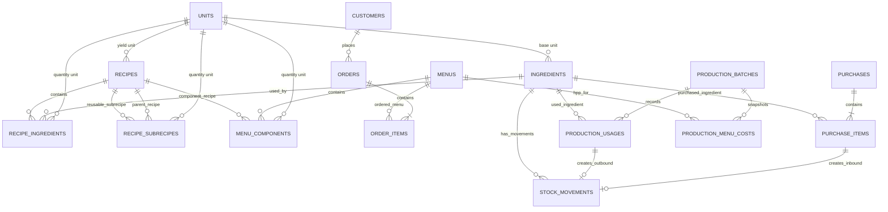

# ERD MVP - Sistem Perencanaan Produksi Katering

Status: disetujui sebagai dasar schema awal MVP. Implementasi SQL ada di `schema.sql`; perubahan berikutnya perlu melalui migrasi/perubahan terkoordinasi.

## Keputusan bisnis yang menjadi dasar

- Target DBMS adalah MySQL Server `8.0.46` (versi server yang dilaporkan dari `SELECT VERSION();`).
- Satu bahan memiliki satu satuan stok/pembelian baku. Kuantitas stok boleh pecahan, misalnya `0.4` karung.
- Setiap bahan memiliki satuan resep dasar dan faktor konversi satuan stok ke satuan dasar, misalnya `1 karung beras = 5.000 g`.
- Resep menyimpan hasil/yield dan dapat memakai bahan langsung maupun subresep yang dapat digunakan ulang.
- Menu tersusun dari resep komponen.
- Pesanan menyimpan tanggal acara dan tanggal produksi. Tanggal produksi dapat lebih awal.
- Pesanan hanya masuk perencanaan jika berstatus `confirmed`; status `cancelled` dikecualikan.
- Pesanan tidak dapat diubah mulai awal hari D-2, dihitung dari tanggal acara.
- HPP bahan memakai biaya rata-rata tertimbang bergerak. Pemakaian dicatat dengan biaya rata-rata yang berlaku saat transaksi.
- Pembelian disarankan dalam bilangan bulat satuan stok baku; daftar belanja dibulatkan ke atas ke satuan stok baku berikutnya.
- Penyesuaian stok fisik dicatat sebagai pergerakan stok dengan alasan wajib.
- HPP per porsi disimpan sebagai snapshot untuk setiap menu pada batch produksi.
- Kebutuhan bahan per tanggal produksi dihitung dari pesanan dan resep. Untuk MVP, hasil perhitungan rencana tidak disimpan sebagai tabel terpisah.

## ERD konseptual

## Tabel dan tanggung jawab

### `units`

Satuan standar yang digunakan resep dan hasil resep.

- `id` - primary key.
- `name`, `symbol` - misalnya gram (`g`), kilogram (`kg`), mililiter (`ml`), liter (`l`), buah (`pcs`), porsi.
- `dimension` - kelompok konversi seperti `mass`, `volume`, `count`, atau `portion`.
- `to_base_factor` - faktor ke satuan dasar dimensinya; satuan dasar menggunakan faktor `1`.

Jangan mengonversi massa ke volume (contoh gram ke mililiter) tanpa data densitas khusus bahan.

### `ingredients`

- `id` - primary key.
- `name` - nama bahan baku.
- `base_unit_id` - FK ke `units`; satuan yang digunakan dalam resep.
- `stock_unit_name` - satuan stok/pembelian baku khusus bahan, misalnya `karung 5 kg`.
- `stock_to_base_factor` - jumlah satuan dasar dalam satu satuan stok, misalnya `5000` gram per karung.
- `is_active` - penanda apakah bahan masih digunakan.

Untuk MVP, semua pembelian bahan dicatat dalam satuan stok baku bahan tersebut. Perubahan ukuran kemasan perlu memperbarui konversi dengan hati-hati.

### `recipes`

- `id` - primary key.
- `name` - nama resep atau komponen.
- `yield_quantity`, `yield_unit_id` - jumlah dan satuan hasil resep.
- `is_active` - penanda resep masih digunakan.

Satu resep dapat menjadi komponen menu dan/atau subresep. Aplikasi harus menolak relasi subresep yang membentuk siklus.

### `recipe_ingredients`

Bahan baku langsung yang digunakan untuk menghasilkan satu yield resep.

- `recipe_id` - FK ke `recipes`.
- `ingredient_id` - FK ke `ingredients`.
- `quantity`, `unit_id` - jumlah bahan dan satuan resep.

Contoh: resep ayam goreng dengan yield 20 porsi memakai 1.000 g bawang.

### `recipe_subrecipes`

Subresep yang digunakan oleh resep induk.

- `parent_recipe_id` - FK ke resep induk.
- `subrecipe_id` - FK ke resep yang dapat digunakan ulang.
- `quantity`, `unit_id` - jumlah hasil subresep yang dipakai untuk satu yield resep induk.

### `menus` dan `menu_components`

`menus` menyimpan menu yang dipesan pelanggan. `menu_components` menghubungkan menu dengan resep komponen.

- `menus`: `id`, `name`, `description`, `is_active`.
- `menu_components`: `menu_id`, `recipe_id`, `quantity_per_portion`, `unit_id`.

`quantity_per_portion` menyatakan jumlah hasil resep komponen yang diperlukan untuk satu porsi menu.

### `customers`

- `id` - primary key.
- `name`, `phone`, `notes` - informasi pelanggan yang diperlukan operasional.

### `orders` dan `order_items`

- `orders`: `id`, `customer_id`, `event_date`, `production_date`, `status`, `notes`, `created_at`, `updated_at`.
- `order_items`: `id`, `order_id`, `menu_id`, `portion_count`.

Status MVP: `draft`, `confirmed`, `cancelled`. Batas perubahan mulai awal D-2 adalah aturan service berdasarkan `event_date`, bukan sekadar validasi form. Tentukan zona waktu aplikasi saat implementasi.

### `purchases` dan `purchase_items`

- `purchases`: `id`, `purchased_at`, `supplier_name`, `notes`.
- `purchase_items`: `id`, `purchase_id`, `ingredient_id`, `quantity_stock_unit`, `unit_price_stock`.

Harga dicatat per satuan stok baku agar pembelian dan valuasi stok memakai unit yang sama.
Untuk MVP, `quantity_stock_unit` pembelian harus berupa bilangan bulat positif. Daftar belanja membulatkan kekurangan ke atas ke bilangan bulat satuan stok baku.

### `production_batches` dan `production_usages`

- `production_batches`: `id`, `production_date`, `status`, `created_at`; satu tanggal produksi hanya memiliki satu batch untuk MVP. Status MVP: `planned`, `in_progress`, `completed`, `cancelled`.
- `production_usages`: `id`, `production_batch_id`, `ingredient_id`, `quantity_stock_unit`, `stock_to_base_factor_at_use`, `unit_cost_stock_at_use`.

Satu batch mewakili pencatatan produksi pada satu tanggal. Jumlah pemakaian aktual disimpan dalam satuan stok agar sesuai dengan ledger stok; faktor konversi disalin saat pemakaian agar jumlah dalam satuan resep dapat direkonstruksi jika konfigurasi bahan berubah.

### `production_menu_costs`

Snapshot HPP resep per porsi untuk menu yang diproduksi pada suatu batch.

- `production_batch_id` - FK ke `production_batches`.
- `menu_id` - FK ke `menus`.
- `portion_count` - jumlah porsi menu yang direncanakan/diproduksi pada batch.
- `hpp_per_portion` - HPP per porsi pada saat snapshot.
- `total_hpp` - total HPP untuk `portion_count` porsi pada saat snapshot.
- `calculated_at` - waktu perhitungan snapshot.

Kombinasi `production_batch_id` dan `menu_id` unik. Snapshot dihitung dari resep menu dan biaya rata-rata bahan yang berlaku saat batch dimulai (saat status berubah dari `planned` ke `in_progress`); HPP menu saat ini tetap dapat dihitung ulang dari resep dan biaya saat ini. `total_hpp` dihitung dari jumlah porsi dikali HPP per porsi.

### `stock_movements`

Ledger perubahan stok; saldo dihitung dari seluruh pergerakan, bukan diedit langsung.

- `id` - primary key.
- `ingredient_id` - FK ke `ingredients`.
- `purchase_item_id` - FK nullable ke `purchase_items` untuk barang masuk.
- `production_usage_id` - FK nullable ke `production_usages` untuk pemakaian produksi.
- `movement_type` - `purchase`, `production_usage`, atau `adjustment`.
- `quantity_delta_stock_unit` - perubahan bertanda: positif untuk masuk, negatif untuk keluar.
- `unit_cost_stock` - biaya per satuan stok yang digunakan untuk valuasi pergerakan.
- `occurred_at`, `notes` - waktu dan keterangan.

Penyesuaian stok manual tidak memiliki sumber pembelian atau pemakaian produksi, tetapi wajib memiliki catatan alasan. Perubahan tabel sumber dan ledger harus dilakukan dalam satu transaksi database.

## Aturan integritas dan perhitungan

- Kuantitas dan harga menggunakan tipe desimal (`DECIMAL`), bukan floating point.
- `quantity` dan `portion_count` harus lebih besar dari nol; jumlah perubahan stok tidak boleh nol.
- Kuantitas pembelian dalam satuan stok baku harus bilangan bulat positif; stok tersisa setelah pemakaian tetap boleh pecahan.
- Satu pergerakan stok hanya boleh berasal dari satu sumber: item pembelian, pemakaian produksi, atau penyesuaian. Sumber pembelian/pemakaian tidak boleh membuat pergerakan ganda.
- Unit resep harus memiliki dimensi yang kompatibel dengan satuan dasar bahan atau yield subresep.
- `stock_to_base_factor` harus lebih besar dari nol.
- Rencana kebutuhan mengembangkan menu -> komponen -> subresep sampai bahan baku, lalu mengonversi hasil resep ke satuan stok dan mengalikan kebutuhan per porsi dengan porsi pesanan pada tanggal produksi.
- Kekurangan bahan = kebutuhan dan stok tersedia dalam satuan stok yang sama. Daftar belanja dibulatkan ke atas ke bilangan bulat satuan stok baku berikutnya.
- Biaya rata-rata bergerak setelah pembelian = `(nilai stok sebelum pembelian + nilai pembelian) / jumlah stok setelah pembelian`. Pemakaian menggunakan biaya rata-rata yang berlaku saat pemakaian dicatat.
- Snapshot HPP menu per batch menyimpan hasil perhitungan resep pada saat batch dimulai agar perubahan harga atau resep berikutnya tidak mengubah angka historis tersebut.
- Perubahan tanggal, status pesanan, dan resep setelah produksi dapat mengubah hasil rencana. Laporan pemakaian aktual menggunakan catatan produksi, bukan menghitung ulang resep.
- Pemeriksaan siklus resep bertingkat dan kecocokan dimensi satuan dilakukan oleh service.
- Faktor konversi satuan stok untuk bahan yang sudah memiliki pergerakan tidak boleh diubah langsung. Perubahan kemasan memerlukan prosedur migrasi atau penyesuaian stok yang menjaga histori.

## Batasan MVP dan aturan service

- Informasi pemasok disimpan sebagai nama teks pada pembelian; tabel pemasok terpisah belum diperlukan untuk MVP.
- Pesanan yang dikonfirmasi harus memiliki minimal satu item; pemeriksaan ini dilakukan oleh service.
- Perubahan pesanan dikunci oleh service mulai awal D-2, berdasarkan tanggal acara.
- Penggunaan resep yang membentuk siklus, kecocokan dimensi satuan, stok negatif, perubahan faktor konversi bahan yang sudah bertransaksi, biaya rata-rata bergerak, dan pembuatan snapshot HPP wajib ditangani dalam transaksi/aturan service.
- `CREATE TABLE IF NOT EXISTS` pada schema hanya untuk bootstrap awal, bukan mekanisme migrasi perubahan skema.
